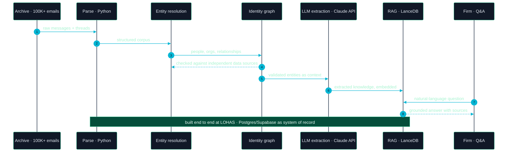
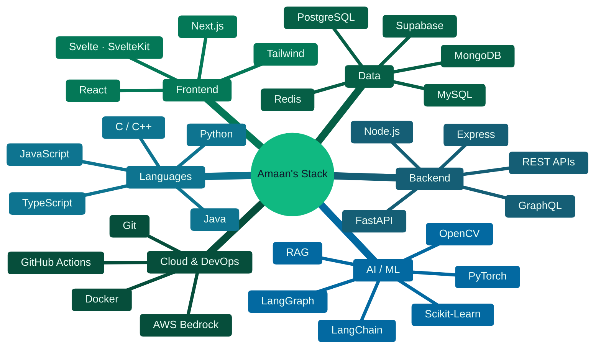
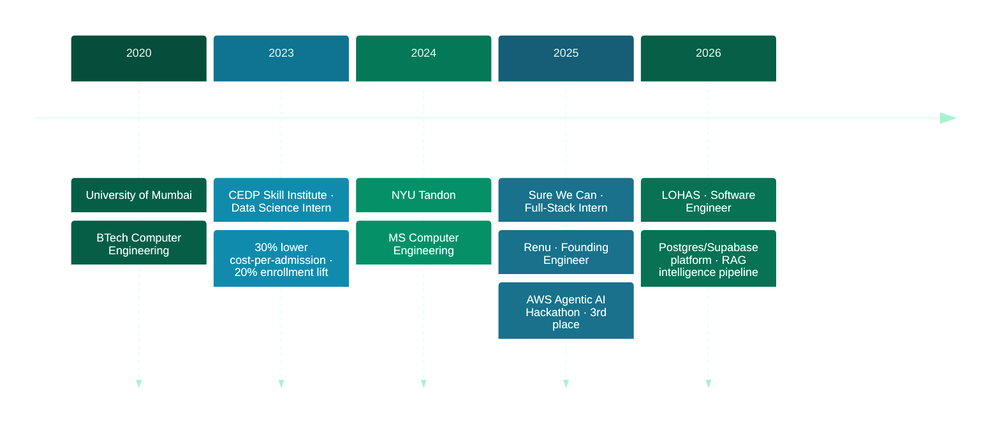
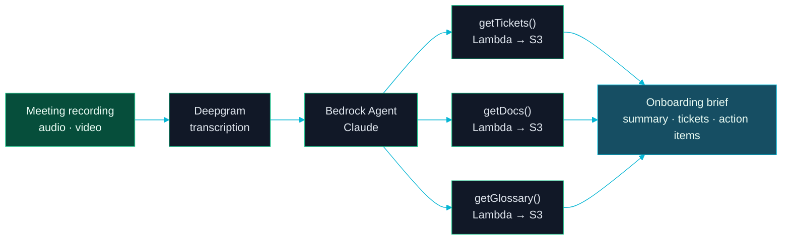

```bash
$ whoami
```

```yaml
name:        Amaan Ansari
role:        Software Engineer · Full-Stack & Applied AI
focus:       full-stack products, data pipelines, LLM / RAG infrastructure
based_in:    New York, NY
currently:   LOHAS — Postgres/Supabase platform, Retool, Claude API, RAG
education:   MS Computer Engineering @ NYU Tandon · BTech Computer Engineering @ University of Mumbai
credentials: 3rd place · AWS Agentic AI Hackathon NYC 2025 · 2× IJRASET publications
reachable:   ama10595@nyu.edu · linkedin.com/in/amaanansari970
```

<p>
  <a href="https://github.com/Amaan2k"></a>
  <a href="https://www.linkedin.com/in/amaanansari970/"></a>
  <a href="mailto:ama10595@nyu.edu"></a>
</p>

---

### &nbsp;❯&nbsp; What I build

<table>
<tr>
<td width="33%" valign="top" align="center">

**Full-Stack Products**

<sub>Next.js, React and Node.js apps on PostgreSQL and MongoDB, shipped to real users and kept running in Docker.</sub>

</td>
<td width="33%" valign="top" align="center">

**Data & Intelligence Pipelines**

<sub>Turning messy archives and spreadsheets into structured, entity-resolved data you can query and trust.</sub>

</td>
<td width="33%" valign="top" align="center">

**Agentic AI Infrastructure**

<sub>RAG layers, LLM extraction and the guardrails (policy, budgets, audit) that make agents safe to use in production.</sub>

</td>
</tr>
</table>

---

### &nbsp;❯&nbsp; How an email becomes an answer in my intelligence pipeline



---

### &nbsp;❯&nbsp; Engineering principles

> **Move the rules into the database.** Balances, fees and caching live in SQL triggers and constraints, so every client gets the same answer.

> **Agents get guardrails, not root keys.** Scoped identity, allow/deny policy, budgets and a replayable audit log come before the first tool call.

> **Ship it, then make it survive.** Containerize, isolate services, persist state. The second deploy should be as easy as the first.

---

### &nbsp;❯&nbsp; Technology ecosystem



<sub>Primary languages &nbsp;→&nbsp; <code>Python</code> · <code>TypeScript</code> · <code>JavaScript</code> · <code>SQL</code> · <code>Java</code> · <code>C++</code> &nbsp;&nbsp;·&nbsp;&nbsp; Also in production &nbsp;→&nbsp; <code>Retool</code> · <code>Claude API</code> · <code>LanceDB</code> · <code>Twilio</code> · <code>Google Maps API</code> · <code>Leaflet.js</code> · <code>pandas</code> · <code>NumPy</code> · <code>Power BI</code></sub>

---

### &nbsp;❯&nbsp; Career journey



| Period | Company | Role | Key impact |
|:--|:--|:--|:--|
| **Jun 2026 — now** | [LOHAS](https://lohas.org) | Software Engineer | Replaced 80+ linked spreadsheets with a PostgreSQL/Supabase + Retool system · SQL triggers for balance caching and per-transaction fees · RAG pipeline over 100K+ emails |
| **Nov 2025 — Mar 2026** | [Renu](https://renunyc.com) | Founding Engineer | Next.js/TypeScript/PostgreSQL app for sharing free items across NYC on a Leaflet map · Docker multi-stage builds · GraphQL references keep 500+ listings in sync with no schema migration |
| **Jun 2025 — Aug 2025** | Sure We Can | Full-Stack Software Engineer Intern | Transportation scheduling platform for 100+ active users · 20+ REST endpoints behind a 5-layer middleware stack · Twilio + Google Maps integrations |
| **Jan 2023 — Sep 2023** | CEDP Skill Institute | Data Science Intern | 30% lower cost-per-admission from marketing ROI analysis · 20% enrollment lift · Power BI KPI reporting moved from weekly to daily |

---

### &nbsp;❯&nbsp; Featured engineering projects

<details open>
<summary><b>AI Onboarding Copilot</b> &nbsp;—&nbsp; 🥉 3rd place, AWS Agentic AI Hackathon NYC 2025 &nbsp;·&nbsp; <a href="https://github.com/Amaan2k/ShadowEngineer-AWS-Hackathon-2025">repo</a></summary>

<br>

Shortens ramp-up for new engineers. Upload a standup or tutorial recording: **Deepgram** transcribes it, then a **Bedrock Agent** (Claude) calls Lambda tools to match it to the **Jira tickets**, **S3 docs** and **glossary terms** it mentions. The result is a plain-English summary, a list of tickets to start on, and action items for the first day.



<sub>`AWS Bedrock` `Claude` `AWS Lambda` `Amazon S3` `Deepgram` `MCP` `JavaScript` `Node.js`</sub>

</details>

<details>
<summary><b>agentgate</b> &nbsp;—&nbsp; a gateway that enforces policy and budgets between LLM agents and internal APIs &nbsp;·&nbsp; <a href="https://github.com/Amaan2k/agentgate">repo</a></summary>

<br>

An API gateway built for agents instead of services. Point it at an **OpenAPI spec** and it generates a function-calling tool catalog. Each agent gets scoped API keys / JWTs, **glob-based allow/deny policies** that deny by default, and **Redis-backed rate limits and daily cost budgets** per agent and per tool. Every call, allowed or denied, is written to a **Postgres audit log** that can be replayed, and each request is traced with **OpenTelemetry**.

```mermaid
%%{init: {"theme":"base","themeVariables":{"darkMode":true,"background":"#0F172A","git0":"#10B981","gitBranchLabel0":"#0F172A","primaryColor":"#111827","primaryBorderColor":"#10B981","primaryTextColor":"#E2E8F0","secondaryColor":"#064E3B","secondaryBorderColor":"#34D399","secondaryTextColor":"#ECFDF5","tertiaryColor":"#0B1220","tertiaryBorderColor":"#06B6D4","tertiaryTextColor":"#E2E8F0","mainBkg":"#111827","nodeBorder":"#10B981","clusterBkg":"#0B1220","clusterBorder":"#1E293B","lineColor":"#06B6D4","textColor":"#A7F3D0","edgeLabelBackground":"#0F172A","actorBkg":"#111827","actorBorder":"#10B981","actorTextColor":"#E2E8F0","actorLineColor":"#334155","signalColor":"#06B6D4","signalTextColor":"#A7F3D0","labelBoxBkgColor":"#111827","labelBoxBorderColor":"#10B981","labelTextColor":"#E2E8F0","loopTextColor":"#A7F3D0","noteBkgColor":"#064E3B","noteBorderColor":"#34D399","noteTextColor":"#ECFDF5","activationBkgColor":"#047857","activationBorderColor":"#34D399","sequenceNumberColor":"#0F172A","cScale0":"#064E3B","cScaleLabel0":"#ECFDF5","cScalePeer0":"#34D399","cScale1":"#0E7490","cScaleLabel1":"#ECFDF5","cScalePeer1":"#34D399","cScale2":"#047857","cScaleLabel2":"#ECFDF5","cScalePeer2":"#34D399","cScale3":"#155E75","cScaleLabel3":"#ECFDF5","cScalePeer3":"#34D399","cScale4":"#065F46","cScaleLabel4":"#ECFDF5","cScalePeer4":"#34D399","cScale5":"#0369A1","cScaleLabel5":"#ECFDF5","cScalePeer5":"#34D399","cScale6":"#064E3B","cScaleLabel6":"#ECFDF5","cScalePeer6":"#34D399","cScale7":"#0E7490","cScaleLabel7":"#ECFDF5","cScalePeer7":"#34D399","cScale8":"#047857","cScaleLabel8":"#ECFDF5","cScalePeer8":"#34D399","cScale9":"#155E75","cScaleLabel9":"#ECFDF5","cScalePeer9":"#34D399","cScale10":"#065F46","cScaleLabel10":"#ECFDF5","cScalePeer10":"#34D399","cScale11":"#0369A1","cScaleLabel11":"#ECFDF5","cScalePeer11":"#34D399"}}}%%
flowchart LR
    A["LLM agent"] --> B["Auth<br>API key · JWT"]
    B --> C["Policy<br>allow / deny"]
    C --> D["Redis<br>rate limit · budget"]
    D --> E["OpenAPI-derived<br>tool proxy"]
    E --> F["Internal REST API"]
    B & C & D & E -.-> G[("Postgres<br>audit log · replay")]
    style A fill:#064E3B,stroke:#34D399,color:#ECFDF5
    style G fill:#164E63,stroke:#06B6D4,color:#ECFDF5
```



<sub>`Python` `FastAPI` `SQLAlchemy` `PostgreSQL` `Redis` `OpenTelemetry` `JWT` `Docker Compose`</sub>

</details>

<details>
<summary><b>StreamLedger</b> &nbsp;—&nbsp; an event-sourced CQRS ledger that prevents double-spends &nbsp;·&nbsp; <a href="https://github.com/Amaan2k/streamledger">repo</a></summary>

<br>

A ledger for balances and inventory that stays correct under concurrent writes. All state changes go to an **append-only event log**. **Optimistic concurrency** (compare-and-swap on the stream version) stops two racing withdrawals from both succeeding, and **dedupe keys** make retried commands return the original result. Read-model projections track a checkpoint, so messages redelivered by **Kafka / NATS JetStream** are applied only once.

<sub>`Go` `gRPC` `Event Sourcing` `CQRS` `Kafka` `NATS JetStream` `Prometheus`</sub>

</details>

<details>
<summary><b>netcode-arena</b> &nbsp;—&nbsp; server-authoritative multiplayer netcode built from scratch &nbsp;·&nbsp; <a href="https://github.com/Amaan2k/netcode-arena">repo</a></summary>

<br>

A 2-player top-down arena that implements real game netcode: **client-side prediction**, **server reconciliation** that replays inputs the server hasn't acknowledged, and **snapshot interpolation** for the remote player. Client and server share one deterministic simulation core in pure C#, and a headless **UDP dedicated server** runs in Docker. It is tested with simulated latency and packet loss.

<sub>`C#` `.NET` `UDP` `Docker` `Unity (optional client)`</sub>

</details>

<details>
<summary><b>Adversarial Robustness in Neural Networks</b> &nbsp;—&nbsp; ResNet-34 accuracy cut from 76% to 2% with ε = 0.02 &nbsp;·&nbsp; <a href="https://doi.org/10.22214/ijraset.2025.72811">paper</a></summary>

<br>

Implemented **FGSM**, **PGD** and **patch-based attacks** on **ResNet-34** and **DenseNet-121** with ImageNet-1K. Top-1 accuracy drops from **76% to 2%** under perturbations that are almost invisible (ε = 0.02). Published in IJRASET (2025).

<sub>`Python` `PyTorch` `ImageNet-1K` `Computer Vision`</sub>

</details>

<details>
<summary><b>Accountill</b> &nbsp;—&nbsp; MERN invoicing platform for freelancers and small businesses &nbsp;·&nbsp; <a href="https://github.com/Amaan2k/accountill">repo</a></summary>

<br>

A full-stack invoicing app for creating and emailing invoices, receipts, estimates, quotes and bills, with PDF generation, due-date tracking and a business dashboard.

<sub>`MongoDB` `Express` `React` `Node.js`</sub>

</details>

<details>
<summary><b>Scholarly Insights</b> &nbsp;—&nbsp; discover and discuss arXiv research papers &nbsp;·&nbsp; <a href="https://github.com/Amaan2k/scholarly-insights">repo</a></summary>

<br>

A team-built web app for finding arXiv papers and discussing them in threaded comments with notifications. It has a Django REST backend with arXiv API integration and a React frontend.

<sub>`Python` `Django` `Django REST Framework` `React` `arXiv API`</sub>

</details>

---

### &nbsp;❯&nbsp; Publications

- **Automated Market Intelligence: A Multi-Agent Approach with MCP** (2025) · *Amaan Ansari, Amaan Mithani, Gaurav Ghop* · [DOI: 10.22214/ijraset.2025.73799](https://doi.org/10.22214/ijraset.2025.73799)
- **Adversarial Attacks on Neural Networks: Approach, Findings, and Analysis** (2025) · *Amaan Ansari, Amaan Mithani, Kunaal Vadgama, Gaurav Ghop* · [DOI: 10.22214/ijraset.2025.72811](https://doi.org/10.22214/ijraset.2025.72811)

---

### &nbsp;❯&nbsp; Impact at a glance

<table>
<tr>
<td align="center" width="20%"><b>100K+</b><br><sub>emails structured for RAG</sub></td>
<td align="center" width="20%"><b>80+</b><br><sub>spreadsheets replaced</sub></td>
<td align="center" width="20%"><b>500+</b><br><sub>live listings at Renu</sub></td>
<td align="center" width="20%"><b>100+</b><br><sub>active users served</sub></td>
<td align="center" width="20%"><b>3rd</b><br><sub>AWS Agentic AI Hackathon</sub></td>
</tr>
</table>

---

### &nbsp;❯&nbsp; GitHub

<!-- animated contribution graph + stats card, built from real data.
     regenerated daily by .github/workflows/update-profile-art.yml
     (scripts/fetch_contributions.py → render_heatmap_svg.py → render_stats_svg.py) -->

<div align="center">

<h3><code>amaan@github ~ $ ./contributions.sh</code></h3>


<br>
<br>

<h3><code>amaan@github ~ $ ./stats.sh</code></h3>



</div>

---

### &nbsp;❯&nbsp; Currently exploring

```text
→ guardrails and evaluation for agentic tool use
→ entity resolution + knowledge graphs as grounding for RAG
→ event-sourced backends that stay correct under concurrency
```

---

<div align="center">

```bash
$ reach me
→ email     ama10595@nyu.edu
→ linkedin  linkedin.com/in/amaanansari970
→ github    github.com/Amaan2k
→ based     New York, NY
```

<sub>Open to software engineering roles in full-stack, backend and applied AI.</sub>

</div>
